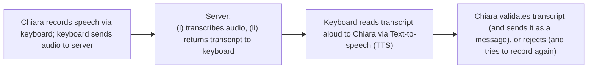
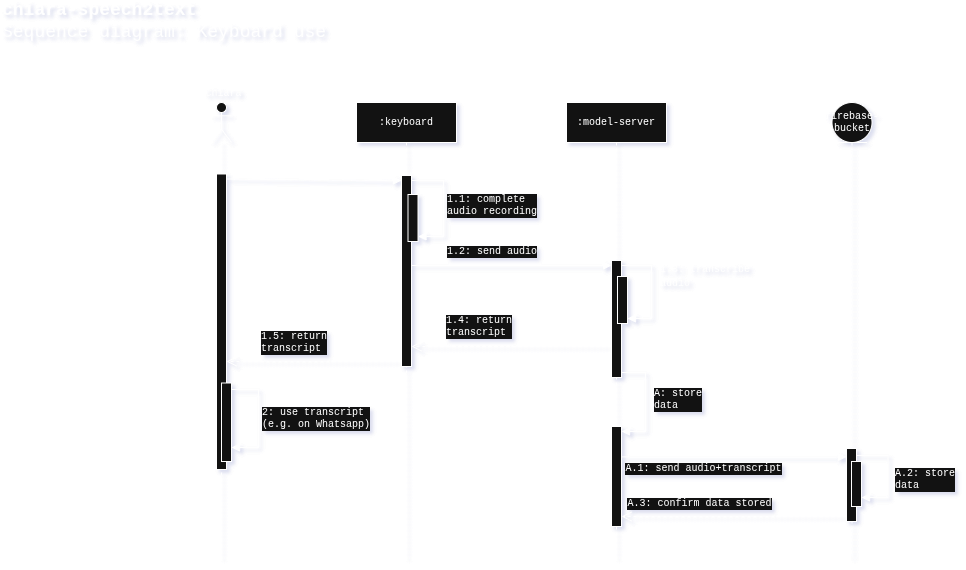
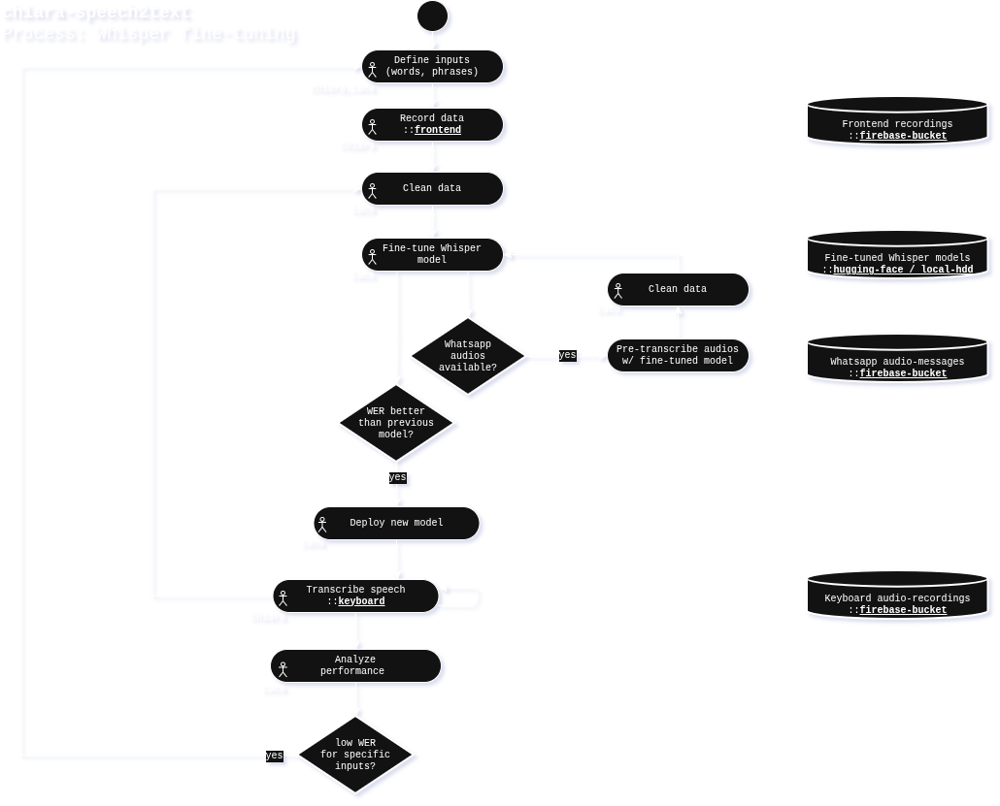
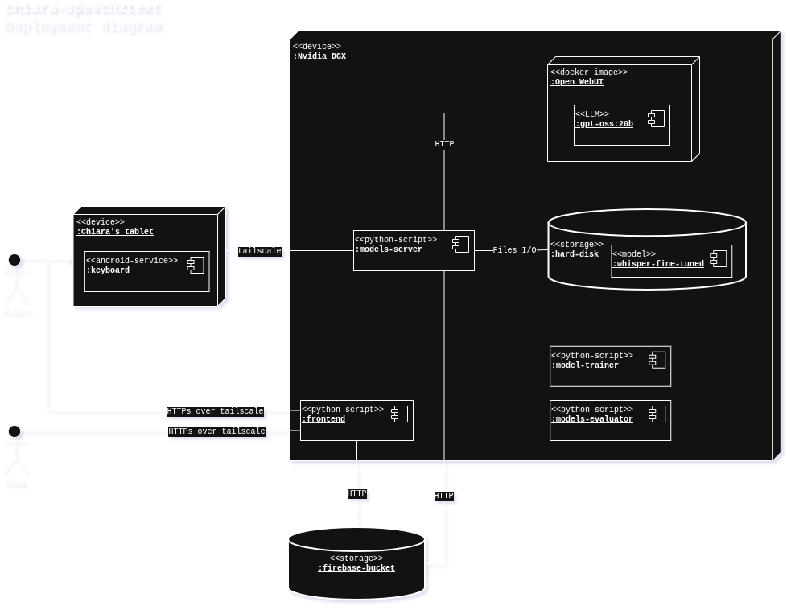

# 1. Introduction
`chiara-speech2text` is a software system for Automatic Speech Recognition (ASR) in users with atypical speech.
- The [project page](https://luca-randazzo.github.io/chiara-speech2text.github.io/) introduces the project (and provides demo videos / screenshots)
- This document provides a technical description of the system and this repo

# 2. System description

## Modules
The system is composed of the following modules:
- `frontend`: webapp to create and curate the datasets used to train the model, including functionalities to:
    - record users' speech
        - users can upload custom words and phrases on which to train the model 
    - edit the dataset, e.g.:
        - edit transcripts
        - listen to- and delete- low quality recordings not suited for model-training
- `model-trainer`: Python notebooks to:
    - import datasets generated by `frontend` module
    - train fine-tuned voice recognition models (based on OpenAI Whisper) using the datasets
- `fine-tuned models`: binary files containing the fine-tuned models (bias, weights, architecture, etc), as output'd by `model-trainer`
- `model-server`: Python webserver exposing services that:
    - (i) accept audio inputs, and
    - (ii) transcribe audios using the `fine-tuned models`  
- `keyboard`: custom Android keyboard to:
    - record user's speech
    - send recorded audios to `model-server`
    - show, edit transcripts returned by `model-server`   
    - deploy transcript exposing a standard Android input-method (keyboard), for seamless use e.g. in Whatsapp
    - provide suggestions for words similar to the recognized ones (using Levenshtein distance)
- `models-evaluator`: Python notebooks to evaluate amd compare performance (e.g. WER) of different fine-tuned models
- `storage`: Google Firebase storage bucket to store audio recordings and transcripts
- `utils`: Python utils to e.g trim audios, migrate data etc

## Repo structure
The repo is organised as follows:
```
chiara-speech2text/
├── assets/            Sample audio files
├── docs/              Documentation files
├── envs/              Environment variables
├── frontend/          Webapp for dataset recording/curating
├── keyboard/          Android keyboard for users to record and transcribe their speech
├── model-server/      FastAPI server for GPU-based inference
├── model-trainer/     Notebooks for datasets generation and fine-tuning ASR models
├── models-evaluator/  Notebooks to evaluate adn compare models performances (e.g. WER)
└── utils/             Data processing utilities
```

## Diagrams
### Main use-flow
The main use flow is shown in the diagram below


### Keyboard use
The diagram below shows the sequence for keyboard use.


### Fine-tuning process
The image below shows the process which was employed to iteratively fine-tune models for Chiara.


The process can be summarized in the following steps:
1. Luca and Chiara (with help from their father and mother), defined a set of inputs (words / phrases) they deemed useful for Chiara's daily communication (based on what she typically communicates over Whatsapp)
2. Chiara recorded ~1h of her speech for the defined inputs, through the `frontend` module. Audios + corresponding text was stored in a firebase storage
3. Luca cleaned audios (e.g. removed bad recordings) to ensure clean data was available for models-training 
4. A model was fine-tuned using the labeled data (audios + text) from (2) and (3)
5. The fine-tuned model was used to transcribe batch of other available Chiara's audios (i.e. Whatsapp audio messages which Chiara exchanged with Luca over previous years)
6. Luca manually labeled the Whatsapp audios (i.e. generated draft transcripts via the fine-tuned model, listened to the audios and edited the corresponding transcripts to ensure transcripts matched what was said in the audios)
7. The data from (6) was used to fine-tune a new model
8. If the fine-tuned models showed bad performance on specific words, steps (1) and (2) were repeated on such words
9. Steps (6) to (8) were iteratively repeated

At around ~10h of properly labeled data (recordings + transcripts), the system was capable of reliably transcribing Chiara's speech - achieveing WER ~15

### Deployment
The diagram and table below show an example of how modules can be deployed.


| Module            | Location                                     |
| ----------------- | -------------------------------------------- |
| frontend          | Nvidia DGX Spark, or Google Cloud Run        |
| model-trainer     | Nvidia DGX Spark, or Google Colab            |
| fine-tuned models | Nvidia DGX Spark, or Hugging Face            |
| model-server      | Nvidia DGX Spark, or Google Cloud Run        |
| keyboard          | Final users's tablet                         |
| models-evaluator  | Nvidia DGX Spark                             |
| storage           | Google Firebase bucket                       |
| utils             | development PC (e.g. Nvidia DGX Spark)       |

# 3. Installation, Setup, Use
Instructions to install, use, and deploy the system are available in [1-setup.md](1-setup.md).

# 4. Requirements
- Usage
    - Some coding skills are required to install, deploy, and use this system
- Data
    - ~10h of labeled data are required to start getting acceptable transcription performance (WER ~15)
    - Data recordings must be <30s (due to the limit imposed by the OpenAi Whisper)
    - Data must contain silences and corresponding empty transcripts
- Deployment
    - A GPU is required for fast (<1s) inference (transcription). CPUs generate transcripts in ~8s
    - The system currently requires paid-services (for hosting)
        - Data hosting costs: https://firebase.google.com/pricing
        - [not currently used] Server hosting costs: https://cloud.google.com/run/pricing 

# 5. Disclaimers
- The code is not clean not well architected (90%+ is AI-generated), nor extremely well controlled (e.g. poorly-descriptive git commits).
    - The main driver during development was functionality, not code-cleanness / reusability
- Credits: The starting point for this project was the [Google Euphonia project](https://sites.research.google/euphonia/about/)
